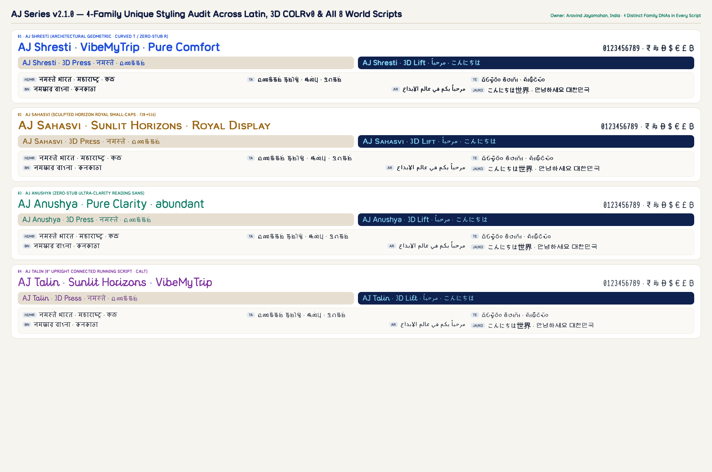

# AJ Series Fonts — SIL Open Font License 1.1 Edition (`v2.1.0`)

Four 100% original CAD-engineered typeface families designed by **Aravind Jayamohan** (India) and structured into a unified **4-Tier Typography Hierarchy**, released under the **SIL Open Font License 1.1** (with no Reserved Font Names) for global distribution via **Google Fonts**, **Google Docs / Sheets / Slides**, **Android**, **ChromeOS**, and open-source operating systems.

## Structured 4-Tier Typography Hierarchy (21 Static Styles)

| Tier | Family | Styles | Role & Design Character |
|---|---|---|---|
| **Level 1 · Headers (`H1`)** | **AJ Sahasvi** | Regular, SemiBold, ExtraBold | Sculpted Horizon Royal Small-Caps (`720→516 UPM`, `1.61:1` calligraphic contrast) |
| **Level 2 · Sub-Headings (`H2–H3`) & UI** | **AJ Shresti** | Regular, SemiBold, ExtraBold + Italics | Architectural modern geometric sans with curved-foot `t` and zero-stub `r` |
| **Level 3 · 3rd-Level Text (`H4`)** | **AJ Talin** | Regular, SemiBold, ExtraBold + Italics | `0°` Precision Straight Connected Running Script (`calt`) + `11°` Italic |
| **Body · Dense Reading (`9pt–13pt`)** | **AJ Anushya** | Regular, SemiBold, ExtraBold + Italics | Zero-tail humanist reading sans with wide open counters (WCAG AAA) |

## Language & Script Coverage
- **100% Google Fonts `GF_Latin_Core`** (324/324 glyphs) + Pan-European & Vietnamese Latin (incl. German Capital `ẞ`).
- **Unique per-family typographic DNA** across **Arabic (RTL)**, **Devanagari (Hindi & Marathi `ळ`/`ट्र`)**, **Tamil**, **Telugu**, **Bengali**, **Japanese Hiragana & Katakana**, and uniform tabular numerals (`0–9`).
- **28 Global Currencies** including Unicode 17.0 **Saudi Riyal (`U+20C1`)** and Unicode 18.0 **UAE Dirham (`U+20C3`)**.

## Automated Foundry QA Certification (`v2.1.0-ofl`)
| Certification Suite | Result |
|---|---|
| **Google Fonts `GF_Latin_Core`** | **21/21 TTFs — 100.0% (0 missing)** |
| **OpenType Sanitizer (OTS)** | **63/63 PASS** (21 TTF + 21 OTF + 21 WOFF2) |
| **FontBakery Universal Profile** | **1,562 PASS · 0 FAIL** across all 4 families |
| **FontBakery OpenType Profile** | **628 PASS · 0 FAIL** across all 4 families |
| **FontBakery Adobe Fonts Profile** | **855 PASS · 0 WARN · 0 FAIL** across all 4 families |

## Zero-Install Global Public CDNs (Live Worldwide)
- **Branded CDN**: `https://fonts.aivibe.cloud/css/aj-series-roles.css`
- **Cloudflare Pages Edge**: `https://aj-series-fonts.pages.dev/css/aj-series-roles.css`
- **jsDelivr Global CDN (750+ PoPs)**: `https://cdn.jsdelivr.net/gh/ajaitech/aj-series-fonts-ofl@v2.1.0-ofl/fonts/webfonts/`

## Repository Structure (Google Fonts Upstream Standard)
- `sources/` — Editable UFO v3 (`.ufo`) source packages for all 21 styles + `gftools-builder` `config-*.yaml` files.
- `fonts/ttf/`, `fonts/otf/`, `fonts/webfonts/` — Compiled static TTF, OTF, and WOFF2 binaries (OTS 100% PASS, FontBakery Universal & OpenType 0 FAIL).
- `documentation/` — Multilingual visual proofs and `ofl/<family>/METADATA.pb` + `DESCRIPTION.en_us.html`.
- `OFL.txt`, `AUTHORS.txt`, `CONTRIBUTORS.txt` — Verbatim SIL Open Font License 1.1 (no Reserved Font Names).

## Live CDN & Interactive Preview
- **Live Specimen & API**: https://fonts.aivibe.cloud · https://aj-series-fonts.pages.dev

## Authorship & Disclosure
- **Sole Original Author & Copyright Holder**: Aravind Jayamohan, India (`aravind.j.naidu@gmail.com`).
- **Tooling Disclosure**: Programmatic CAD Bézier geometry synthesis and OpenType QA validation were assisted by AI engineering tools under the sole creative direction, visual review, and ownership of Aravind Jayamohan.
- **License**: [SIL Open Font License 1.1](OFL.txt) (no Reserved Font Names).
